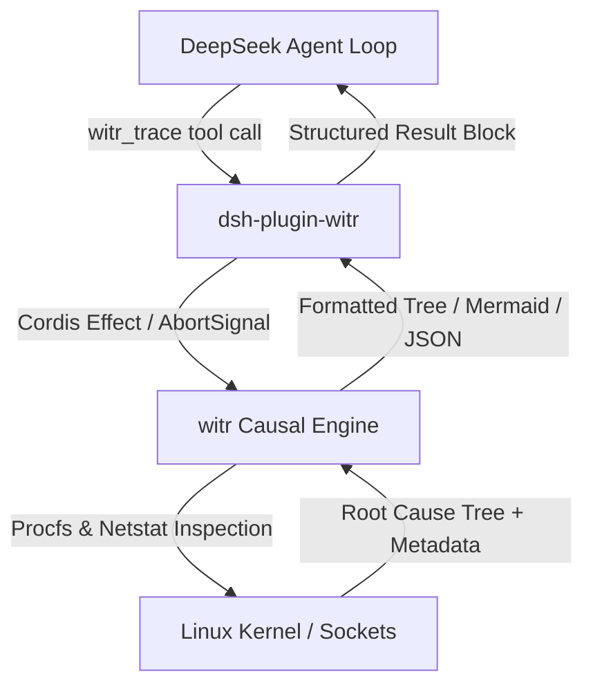
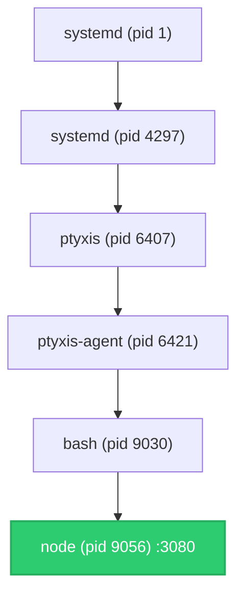

<div align="center">

# `dsh-plugin-witr`

**The causal process & port tracing plugin for [DeepSeek Harness](https://github.com/deepseek-ai/deepseek-harness).**

[](LICENSE)
[](https://github.com/deepseek-ai/deepseek-harness)
[](https://github.com/martinm86867-ops/witr)
[](https://www.typescriptlang.org/)

<p align="center">
  <b>Gives autonomous DeepSeek agents instant root-cause visibility into running processes, port collisions (<tt>EADDRINUSE</tt>), and stuck file locks.</b>
</p>

</div>

---

## The Problem

Autonomous agents frequently stall during development or operational loops when encountering state conflicts:
- A local dev server fails to start with `EADDRINUSE: 3080`.
- An environment command hangs because `/var/lib/dpkg/lock-frontend` is locked.
- A long-lived background worker holds memory, but `ps aux` only shows an uninformative child process without context.

Standard agent workarounds—chaining `ps aux`, `lsof`, `fuser`, `netstat`, and `kill -9`—are fragile, hallucination-prone, and risk accidentally terminating the parent terminal or shell.

## The Solution

`dsh-plugin-witr` wires [`witr`](https://github.com/martinm86867-ops/witr) directly into the DeepSeek Harness tool registry via the **Cordis** plugin lifecycle. 

Instead of guessing, the agent calls `witr_trace` to receive the complete supervisor hierarchy from `systemd` down through terminal emulators, shells, and parent containers in a single deterministic turn.



---

## Features

- **Full Causal Ancestry:** Traces processes backwards through `systemd -> ptyxis -> bash -> node -> esbuild` to pinpoint what launched and maintains the target.
- **Port Collision Resolution:** Translates port numbers (e.g. `3080`, `8080`) directly into the owning PID, parent shell, working directory, and active Git branch.
- **File Lock Diagnostics:** Pinpoints which background process or daemon holds open a file descriptor.
- **Multi-Format Projection:** Supports human-readable diagnostic text, compact hierarchical trees, raw JSON, and **Mermaid.js flowchart diagrams** for visual documentation.
- **DeepSeek Plugin Manager UI:** Fully declared Cordis bundle with metadata, icons, and configurable runtime parameters in the Web UI.
- **Cancellation & Safety:** Strictly read-only; automatically aborts child subprocesses if the agent turn is cancelled via `exec.signal`.

---

## Installation

### Prerequisites

Ensure the `witr` binary is installed in your system PATH (e.g. `/usr/local/bin/witr`):

```bash
# Verify witr binary
witr --version
```

### Method 1: Add via DeepSeek CLI
```bash
dsh plugin --profile web add dsh-plugin-witr
```

### Method 2: Profile Mount (`cordis.patch.yml`)
Add an `- insert:` entry to your active profile patch file (`~/.dsh/profiles/<profile>/cordis.patch.yml`):

```yaml
- insert:
    - id: tool-witr
      name: "dsh-plugin-witr"
      config:
        binaryPath: witr
        timeoutMs: 10000
```

---

## Model Tool Specification: `witr_trace`

When mounted, DeepSeek models gain access to the following tool schema:

```typescript
witr_trace({
  target: string,    // Port number ("3080"), PID ("1234"), process name ("node"), or file path
  kind?: string,      // Optional explicit discriminator: "port" | "pid" | "file" | "name"
  format?: string,    // Output format: "standard" | "tree" | "mermaid" | "dot" | "json"
  exact?: boolean     // Disable substring matching when searching by name
})
```

### Example Agent Interactions

#### 1. Diagnosing an In-Use Port
**Agent call:**
```json
{
  "name": "witr_trace",
  "arguments": {
    "target": "3080",
    "kind": "port"
  }
}
```

**Tool output:**
```text
Target      : node
Process     : node (pid 9056) {forked}
User        : martin
Command     : node --import tsx/esm apps/cli/src/bin.ts web
Started     : 1 hour ago (Wed 2026-10-14 10:05:05 +01:00)

Why It Exists :
  systemd (pid 1) → systemd (pid 4297) → ptyxis (pid 6407) → ptyxis-agent (pid 6421) → bash (pid 9030) → node (pid 9040) → sh (pid 9055) → node (pid 9056)

Source      : sh (shell)
Working Dir : /home/martin/deepseek
Git Repo    : deepseek (master)
Sockets     : 127.0.0.1:3080 (TCP | LISTENING, 2 connections)
```

#### 2. Generating a Visual Markdown Architecture Diagram
**Agent call:**
```json
{
  "name": "witr_trace",
  "arguments": {
    "target": "3080",
    "format": "mermaid"
  }
}
```

**Tool output:**


---

## Configuration Schema

Configured via Cordis YAML or the DeepSeek Web Settings UI:

| Option | Type | Default | Description |
| :--- | :--- | :--- | :--- |
| `binaryPath` | `string` | `"witr"` | Path to the `witr` binary. |
| `timeoutMs` | `number` | `10000` | Subprocess execution timeout in milliseconds. |

---

## Development & Building

```bash
# Install dependencies
pnpm install

# Compile TypeScript
pnpm run build

# Run unit tests (Vitest)
pnpm run test
```

---

## License

[MIT](LICENSE) © 2026 Martin M
